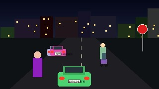
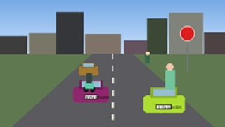

# Ba failure mode bắt buộc của T02

Phân tích dưới đây dùng ảnh dev, thông số đã đóng băng, không dùng GT ẩn. Quan sát trực quan không thay nhãn chính thức.

## night_useful — img_18_1

Targets remain visible at night; a naive mean-brightness cutoff of 60 would reject this useful-looking example. This is a counterfactual rule, not the submitted baseline.

Camera=cam_B; light=night; brightness=32.331; Laplacian=1906.758; saturated tile fraction=0.059. Baseline=KEEP (0.0000); PoC=KEEP (0.0000).

## small_glare — img_18_2

Local white glare obscures detail near the front plate, although global sharpness stays high. Fixed 16x16 tile saturation does not trigger; both submitted methods KEEP. This is a visual finding, not an instructor GT label.

Camera=cam_B; light=night; brightness=34.195; Laplacian=335.208; saturated tile fraction=0.629. Baseline=KEEP (0.0000); PoC=KEEP (0.0388).

## cam_B_soft — img_00_0

cam_B image looks softer than img_00_1 with similar scene geometry; objects remain distinguishable. Current policy KEEP, so no observed false alarm is claimed for this source image.

Camera=cam_B; light=day; brightness=118.440; Laplacian=266.883; saturated tile fraction=0.012. Baseline=KEEP (0.0000); PoC=KEEP (0.0968).

## Cam_B: độ nhạy với quang học mềm

Bổ sung Gaussian radius 0/0.5/1/1.5 trên img_00_1 (dev). Đây là stress có kiểm soát, không phải lỗi đã được GT xác nhận. Không thay threshold triển khai sau thử nghiệm.

| Radius | Laplacian | Baseline | PoC |
|---|---|---|---|
| 0.0 | 1365.639 | KEEP (0.000) | KEEP (0.000) |
| 0.5 | 515.216 | KEEP (0.000) | KEEP (0.000) |
| 1.0 | 49.765 | KEEP (0.378) | KEEP (0.183) |
| 1.5 | 11.379 | RECAPTURE (0.858) | RECAPTURE (0.804) |

Root cause: một ngưỡng Laplacian toàn ảnh có thể phản ứng với quang học mềm thay vì mức hữu ích cho gán nhãn. PoC chuẩn hóa tương phản vẫn không miễn nhiễm. Cần đánh giá theo nhiệm vụ và camera trước khi tự động loại ảnh.
